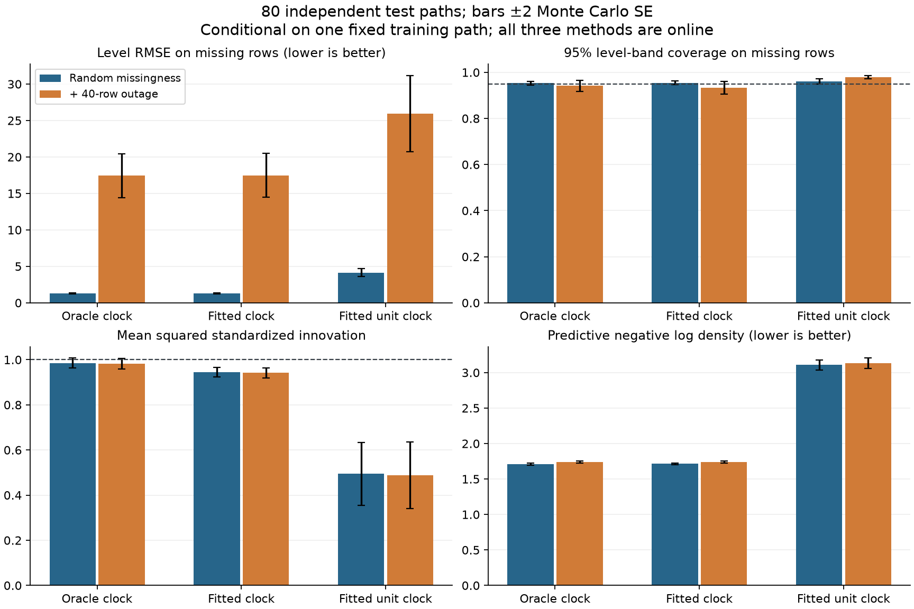
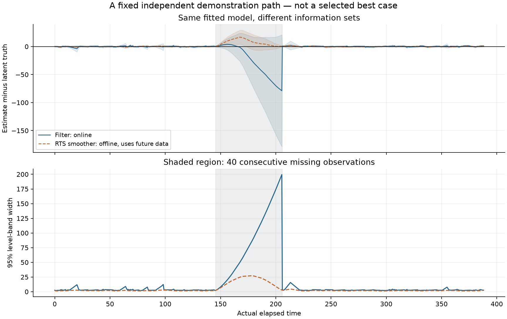

# Irregular-Time Kalman Lab

[](https://github.com/lcx0731/irregular-time-kalman-lab/actions/workflows/tests.yml)

**An observation index is not a clock, and high interval coverage is not enough.**
This small state-space experiment tracks a latent level and slope through uneven
time gaps and missing observations. It compares a real-time-aware Kalman filter
with a fitted unit-time ablation, audits predictive innovations, and demonstrates
why a smoother that uses future data is not an online forecast.

The project is an original implementation of standard numerical methods, with
seeded synthetic data, independent dense-Gaussian checks, and no market, private,
or personally identifying data. It does not reproduce unpublished research.

## Run locally

Python 3.11 or newer:

```bash
python3 -m venv .venv
source .venv/bin/activate
python -m pip install '.[test]'
python -m pytest -W error
kalman-audit --output results
```

The default command runs 80 test trajectories, two missingness scenarios, and
three online models: **480 paired filter evaluations**. For a smaller smoke run:

```bash
kalman-audit --repetitions 6 --output results/smoke
```

Both commands fit their parameters on the same separate 400-row training path.
The checked-in [results](artifacts/summary.json) use seed `20261004`. Exact
Python 3.13 runtime/test versions are recorded in `constraints-python313.txt`:

```bash
python -m pip install -c constraints-python313.txt '.[test]'
```

This is a version snapshot, not a cross-platform binary lockfile. CI uses the
declared compatible version ranges on Python 3.11 and 3.13. After source edits,
reinstall with `python -m pip install --no-deps .`.

## Model and clock

The continuous-time latent state is level `L` and slope `V`:

$$
dL_t=V_t\,dt,\qquad dV_t=\sqrt{q}\,dW_t,\qquad
y_k=L_{t_k}+\epsilon_k,\quad\epsilon_k\sim N(0,r).
$$

For an elapsed gap `h`, the exact transition and process covariance are:

$$
F(h)=\begin{pmatrix}1&h\\0&1\end{pmatrix},\qquad
Q(h)=q\begin{pmatrix}h^3/3&h^2/2\\h^2/2&h\end{pmatrix}.
$$

This is an integrated-Wiener state model. The filter predicts with `F(h), Q(h)`
and updates with the scalar level observation. The innovation is measured
**before** the update. Joseph-form covariance updates help preserve positive
semidefiniteness. At a missing row, only prediction occurs; no interpolation or
invented measurement enters the likelihood. These are standard linear Gaussian
filtering ideas; see [Särkkä (2013), Chapters 3–4](https://users.aalto.fi/~ssarkka/pub/cup_book_online_20131111.pdf).

The code exposes all predicted and filtered states, covariances, innovations,
and the observed-data log likelihood. The prior is defined immediately before
the first observation; no artificial interval precedes that row.

```python
import numpy as np
from irregular_kalman import kalman_filter

result = kalman_filter(
    times=[0.0, 1.3, 4.2, 4.9],
    observations=[0.1, np.nan, 0.4, 1.1],
    q=0.035, r=0.64,
    prior_mean=[0.0, 0.1], prior_cov=np.diag([1.0, 0.1]),
)
print(result.filtered_mean[:, 0])
```

## Experimental design

- True diffusion intensity `q = 0.035`; measurement **variance** `r = 0.64`.
- Every independent path starts from `N([0, 0.1], diag([1, 0.1]))`.
- Time gaps are `Uniform(0.25, 1.75)`, plus an independent `Uniform(3, 7)`
  extension with probability 0.1. Time starts at zero.
- Missing observations are independent Bernoulli events with probability 0.2.
- An independent 400-row training path calibrates noise parameters. No hidden
  states, test observations, or future test metrics enter fitting.
- Each of 80 independent 240-row test paths is evaluated twice: with random
  missingness alone, and with an additional forced outage at zero-based rows
  `[90, 130)`. The underlying path and measurements are identical across masks.
- A separate fixed demonstration path is used for the smoothing figure. It is
  not chosen by searching for a favorable result.

The three online models are:

| Model | Clock | Noise parameters | Interpretation |
|---|---|---|---|
| Oracle clock | Actual elapsed gaps | True `q, r` | Unattainable known-model benchmark |
| Fitted clock | Actual elapsed gaps | Train-only MLE | Time-aware plug-in model |
| Fitted unit clock | Every gap treated as 1 | Its own train-only MLE | Clock-misspecification ablation |

The unit-clock model retains missing rows but discards actual timestamps. It is
allowed to refit **both** noise parameters; it is not forced to use the physical
model's diffusion intensity in the wrong time units. The specified initial prior
is held fixed for all methods, so this is not an exhaustive comparison of
alternative priors or models.

Noise fitting minimizes the observed Gaussian innovation negative log likelihood
in `log(q), log(r)`, using [SciPy L-BFGS-B](https://docs.scipy.org/doc/scipy/reference/generated/scipy.optimize.minimize.html).
Three fixed starts are `(0.01, 0.2)`, `(0.1, 1)`, and `(1, 4)`. Bounds are
`q in [1e-5, 10]`, `r in [1e-4, 100]`; convergence and boundary diagnostics are
saved. Failed fits are rejected rather than silently used. These are bounded
local optimizations, not a claim of global optimality.

### Calibration from the recorded training path

Of 400 training rows, 330 are observed. All three optimizer starts converge for
both models, with neither selected solution at a bound.

| Model | Fitted q | Fitted r | Training negative log likelihood |
|---|---:|---:|---:|
| Fitted clock | 0.030844 | 0.708761 | 576.845584 |
| Fitted unit clock | 3.736090 | 15.315498 | 1105.039922 |

`q` has different clock units in the two models and should not be compared as if
it represented the same physical parameter. `r` is always in squared level units.

## Results: prediction, calibration, and sharpness together

Values below are averages of **per-trajectory** metrics, conditional on the one
fixed training path. RMSE is averaged across trajectories, not computed after
pooling every time point. Full results include Monte Carlo standard errors (MCSE)
for every metric and paired model differences.

| Missingness | Online model | Missing-row RMSE | 95% coverage | Mean 95% width | Mean innovation NIS |
|---|---|---:|---:|---:|---:|
| Random | Oracle clock | 1.2930 | 95.33% | 4.5099 | 0.9856 |
| Random | Fitted clock | 1.2938 | 95.46% | 4.5022 | 0.9443 |
| Random | Fitted unit clock | 4.1331 | 96.03% | 22.7725 | 0.4940 |
| + 40-row outage | Oracle clock | 17.4395 | 94.17% | 48.2801 | 0.9819 |
| + 40-row outage | Fitted clock | 17.4819 | 93.36% | 45.7488 | 0.9421 |
| + 40-row outage | Fitted unit clock | 25.9342 | 97.94% | 271.6498 | 0.4878 |

Coverage and width in this table concern **latent level bands on missing rows**,
not observation prediction intervals. Mean innovation NIS is the average squared
standardized one-step observation residual, evaluated only at observed rows.
Its known-model reference is 1. Innovation mean, observed-sequence lag-one
correlation, all-row errors, and predictive negative log density are also saved.
These are descriptive diagnostics, not multiple formal hypothesis tests.

The mean paired missing-row RMSE differences, fitted clock minus fitted unit clock,
are **-2.8393 (MCSE 0.2627)** for random missingness and **-8.4522 (MCSE 2.4483)**
with the block outage. A negative difference favors the real clock in this
simulation. The unit-clock model has high coverage but much wider bands and worse
predictive density; coverage alone hides that loss of precision. The time-aware
plug-in model is not perfectly calibrated either, and all methods deteriorate
during a long outage.

MCSE is `std(per-path metric, ddof=1) / sqrt(80)`. Paired-difference MCSE is
computed from within-path differences. Time points are **not** treated as
independent replicates; the two missingness scenarios are paired too. These MCSEs
do not include uncertainty from drawing a different training path.



## Filtering is not smoothing

The RTS backward pass estimates past states using the complete observation
sequence. It is intentionally excluded from the online-model comparison. See
[Särkkä (2013), Chapter 8](https://users.aalto.fi/~ssarkka/pub/cup_book_online_20131111.pdf)
for the standard fixed-interval smoother.

A direct causality check shifts all finite demonstration observations from row
150 onward by +10. Earlier filtered state estimates change by **exactly zero**;
earlier smoothed state estimates change by up to **3.4255** (maximum absolute
component across level and slope). Parameters remain fixed during this check.
The figure uses the original, unshifted data, with bands centered on each estimate
after subtracting latent truth for readability.



## Verification and files

41 tests include hand-calculated updates, transition composition, insertion of
unobserved timestamps, positive covariance through an outage, missing-data
likelihood handling, and future-perturbation invariance. An independently written
continuous-time covariance kernel constructs a dense joint Gaussian distribution;
direct conditioning matches the filter, full RTS posterior, and log likelihood
on a small irregular example. Optimizer failure and malformed inputs are tested.

GitHub Actions runs all tests plus a six-trajectory CLI smoke experiment on
Python 3.11 and 3.13. The full 80-trajectory run is recorded locally in:

```text
artifacts/summary.json              Design, calibration, aggregate and paired metrics
artifacts/replications.json         All 480 per-model/per-mask trajectory evaluations
artifacts/demonstration.json        Fixed path, original observations, filter/smoother
artifacts/performance.png           Online evaluation with ±2 MCSE bars
artifacts/outage_and_smoothing.png  Online versus offline information sets
src/irregular_kalman/core.py        Exact transitions, filter, RTS smoother
src/irregular_kalman/fit.py         Independent training-only calibration
src/irregular_kalman/synthetic.py   Seeded generator with separate random streams
src/irregular_kalman/experiment.py  Reproducible paired evaluation
tests/                            Numerical and end-to-end checks
```

## Limits and responsible use

- Linear Gaussian dynamics and exogenous missingness are deliberate simplifications.
  Informative missingness, outliers, unknown change points, seasonality, and
  state-dependent measurement noise are not covered.
- This is a two-dimensional integrated process with known initialization and one
  training path, not a benchmark of general forecasting methods. There is no
  real-data calibration or claim of financial forecasting performance.
- Plug-in intervals treat fitted parameters as known; they do not integrate
  parameter or model uncertainty. Nominal 95% coverage is not guaranteed.
- The unit-clock ablation highlights a specific misspecification. Better
  misspecified models or different training trajectories can change the ranking.
- Full-array storage is linear in sequence length for this fixed state dimension;
  this implementation is not optimized for streaming memory use or very large
  state spaces. Only a scalar observation and positive-definite prior are supported.
- Double precision, optimizer tolerances, and numerical-library versions may
  affect final digits. No production stability or real-time latency claim is made.

Educational use only. Not investment advice, a trading strategy, or a production
risk system. MIT licensed. No personal experience or empirical research result is
claimed by this synthetic exercise.
